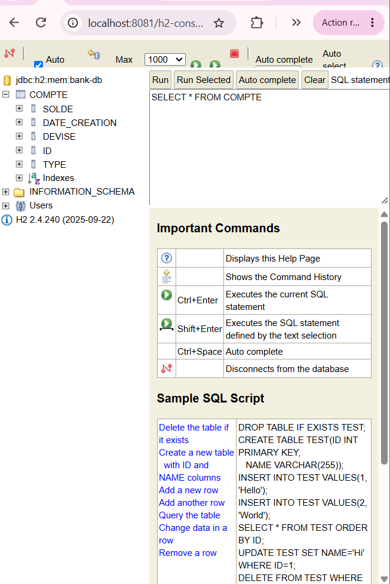

# Activité Pratique N°1 – Micro-service de gestion de comptes bancaires avec Spring Boot

**Module :** Architectures Micro-services – Pr. Mohamed YOUSSFI (ENSET Mohammedia)
**Réalisé par :** Chaimaa Zandar – GLSID3

---

## Sommaire
1. [Objectif](#objectif)
2. [Technologies](#technologies)
3. [Structure du projet](#structure-du-projet)
4. [Étape 1 : Création du projet Spring Boot](#étape-1--création-du-projet-spring-boot)
5. [Étape 2 : Création de l'entité JPA Compte](#étape-2--création-de-lentité-jpa-compte)
6. [Étape 3 : Création de l'interface CompteRepository](#étape-3--création-de-linterface-compterepository)
7. [Étape 4 : Test de la couche DAO](#étape-4--test-de-la-couche-dao)
---

## Objectif
Créer un micro-service permettant de gérer des comptes bancaires : couche DAO avec Spring Data JPA, API REST, documentation Swagger, Spring Data Rest avec projections, DTOs et mappers, couche service, et un web service GraphQL.

## Technologies
- Java 21
- Spring Boot (Web, Data JPA)
- H2 Database
- Lombok

## Structure du projet
src/main/java/ma/enset/bankaccountservice
├── entities
│   └── Compte.java
├── enums
│   └── TypeCompte.java
├── repositories
│   └── CompteRepository.java
└── BankAccountServiceApplication.java
---

## Étape 1 : Création du projet Spring Boot
Le projet a été généré avec Spring Initializr avec les dépendances suivantes :
- **Spring Web** : création des contrôleurs REST
- **Spring Data JPA** : couche d'accès aux données
- **H2 Database** : base de données en mémoire
- **Lombok** : génération automatique des getters, setters et constructeurs

Configuration (`application.properties`) :
- Port du service : `8081`
- Base H2 en mémoire `bank-db`, avec la console accessible sur `http://localhost:8081/h2-console`

---

## Étape 2 : Création de l'entité JPA Compte

### L'énumération `TypeCompte`
Elle définit les deux types de comptes possibles : `COURANT` et `EPARGNE`.

### L'entité `Compte`
| Attribut | Type | Description |
|---|---|---|
| `id` | `String` | Identifiant unique du compte (clé primaire) |
| `dateCreation` | `Date` | Date de création du compte |
| `solde` | `Double` | Solde du compte |
| `devise` | `String` | Devise du compte (MAD, EUR, USD…) |
| `type` | `TypeCompte` | Type du compte (COURANT / EPARGNE) |

Annotations utilisées :
- `@Entity` : indique que la classe est une entité JPA, mappée vers une table
- `@Id` : définit la clé primaire
- `@Enumerated(EnumType.STRING)` : stocke le type du compte sous forme de texte et non d'entier
- `@Data`, `@NoArgsConstructor`, `@AllArgsConstructor`, `@Builder` (Lombok) : génèrent les getters/setters, les constructeurs et le pattern Builder

### Résultat
Au démarrage, Hibernate crée automatiquement la table `COMPTE` dans la base H2 :

---

## Étape 3 : Création de l'interface CompteRepository
L'interface `CompteRepository` hérite de `JpaRepository<Compte, String>`, ce qui fournit automatiquement les opérations CRUD (`save`, `findAll`, `findById`, `deleteById`…) sans aucune implémentation.

Une méthode dérivée a été ajoutée :
- `findByType(TypeCompte type)` : retourne les comptes d'un type donné. Spring Data génère la requête à partir du nom de la méthode.
- ---

## Étape 4 : Test de la couche DAO
Pour tester la couche DAO, un bean `CommandLineRunner` a été ajouté dans la classe principale. Il s'exécute au démarrage de l'application et réalise les opérations suivantes :
1. Insertion de 10 comptes avec un identifiant `UUID`, un solde aléatoire, la devise `MAD` et un type aléatoire (`COURANT` ou `EPARGNE`), en utilisant le pattern Builder de Lombok
2. Affichage de tous les comptes avec `findAll()`
3. Affichage des comptes épargne avec la méthode dérivée `findByType()`

### Résultat dans la console

### Résultat dans la base H2
