# Activité Pratique N°1 – Micro-service de gestion de comptes bancaires avec Spring Boot

**Module :** Architectures Micro-services – Pr. Mohamed YOUSSFI (ENSET Mohammedia)
**Réalisé par :** Chaimaa Zandar – GLSID3

---

## Sommaire
1. [Objectif](#objectif)
2. [Technologies](#technologies)
3. [Étape 1 : Création du projet Spring Boot](#étape-1--création-du-projet-spring-boot)
4. [Étape 2 : Création de l'entité JPA Compte](#étape-2--création-de-lentité-jpa-compte)
5. [Étape 3 : Création de l'interface CompteRepository](#étape-3--création-de-linterface-compterepository)
6. [Étape 4 : Test de la couche DAO](#étape-4--test-de-la-couche-dao)
7. [Étape 5 : Création du Web service RESTful](#étape-5--création-du-web-service-restful)
8. [Étape 6 : Test du web service avec Postman](#étape-6--test-du-web-service-avec-postman)
9. [Étape 7 : Documentation Swagger](#étape-7--documentation-swagger)
10. [Étape 8 : Spring Data Rest et projections](#étape-8--spring-data-rest-et-projections)
11. [Étape 9 : Création des DTOs et Mappers](#étape-9--création-des-dtos-et-mappers)
12.  [Étape 10 : Création de la couche Service (métier)](#étape-10--création-de-la-couche-service-métier)
13.  [Étape 11 : Web service GraphQL](#étape-11--web-service-graphql)
14. [Conclusion](#conclusion)
---

## Objectif
Créer un micro-service permettant de gérer des comptes bancaires : couche DAO avec Spring Data JPA, API REST, documentation Swagger, Spring Data Rest avec projections, DTOs et mappers, couche service, et un web service GraphQL.

## Technologies
- Java 21
- Spring Boot (Web, Data JPA)
- H2 Database
- Lombok
- Springdoc OpenAPI 3.1.0 (Swagger UI)
- - Spring Data Rest
- - Spring for GraphQL (GraphiQL)


---

## Étape 1 : Création du projet Spring Boot
Le projet a été généré avec Spring Initializr avec les dépendances suivantes :
- **Spring Web** : création des contrôleurs REST
- **Spring Data JPA** : couche d'accès aux données
- **H2 Database** : base de données en mémoire
- **Lombok** : génération automatique des getters, setters et constructeurs

Configuration (`application.properties`) :
- Port du service : `8081`
- Base H2 en mémoire `bank-db`, avec la console accessible sur `http://localhost:8081/h2-console`

---

## Étape 2 : Création de l'entité JPA Compte

### L'énumération `TypeCompte`
Elle définit les deux types de comptes possibles : `COURANT` et `EPARGNE`.

### L'entité `Compte`
| Attribut | Type | Description |
|---|---|---|
| `id` | `String` | Identifiant unique du compte (clé primaire) |
| `dateCreation` | `Date` | Date de création du compte |
| `solde` | `Double` | Solde du compte |
| `devise` | `String` | Devise du compte (MAD, EUR, USD…) |
| `type` | `TypeCompte` | Type du compte (COURANT / EPARGNE) |

Annotations utilisées :
- `@Entity` : indique que la classe est une entité JPA, mappée vers une table
- `@Id` : définit la clé primaire
- `@Enumerated(EnumType.STRING)` : stocke le type du compte sous forme de texte et non d'entier
- `@Data`, `@NoArgsConstructor`, `@AllArgsConstructor`, `@Builder` (Lombok) : génèrent les getters/setters, les constructeurs et le pattern Builder

### Résultat
Au démarrage, Hibernate crée automatiquement la table `COMPTE` dans la base H2 :


---

## Étape 3 : Création de l'interface CompteRepository
L'interface `CompteRepository` hérite de `JpaRepository<Compte, String>`, ce qui fournit automatiquement les opérations CRUD (`save`, `findAll`, `findById`, `deleteById`…) sans aucune implémentation.

Une méthode dérivée a été ajoutée :
- `findByType(TypeCompte type)` : retourne les comptes d'un type donné. Spring Data génère la requête à partir du nom de la méthode.
- ---

## Étape 4 : Test de la couche DAO
Pour tester la couche DAO, un bean `CommandLineRunner` a été ajouté dans la classe principale. Il s'exécute au démarrage de l'application et réalise les opérations suivantes :
1. Insertion de 10 comptes avec un identifiant `UUID`, un solde aléatoire, la devise `MAD` et un type aléatoire (`COURANT` ou `EPARGNE`), en utilisant le pattern Builder de Lombok
2. Affichage de tous les comptes avec `findAll()`
3. Affichage des comptes épargne avec la méthode dérivée `findByType()`

### Résultat dans la console
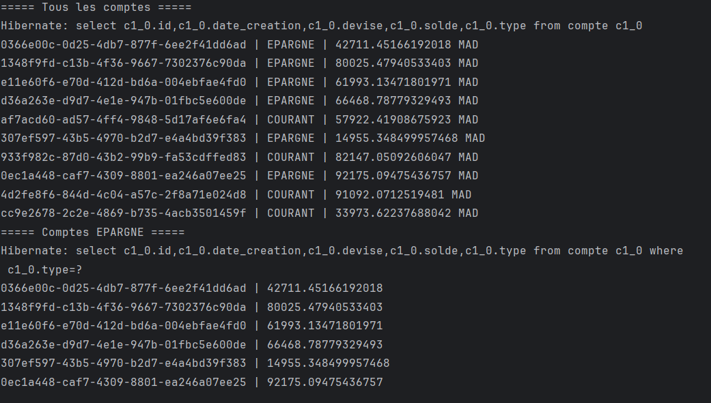

### Résultat dans la base H2
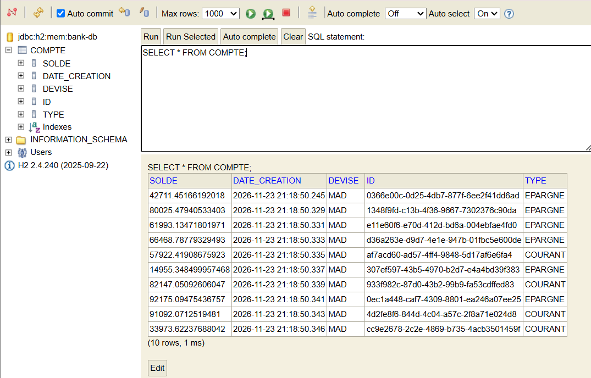
---

## Étape 5 : Création du Web service RESTful
Le contrôleur `CompteRestController` expose les opérations CRUD sur les comptes, sous le préfixe `/api` :

| Méthode HTTP | URL | Description |
|---|---|---|
| `GET` | `/api/comptes` | Lister tous les comptes |
| `GET` | `/api/comptes/{id}` | Consulter un compte |
| `POST` | `/api/comptes` | Ajouter un compte (id et date générés automatiquement si absents) |
| `PUT` | `/api/comptes/{id}` | Modifier un compte (seuls les champs fournis sont modifiés) |
| `DELETE` | `/api/comptes/{id}` | Supprimer un compte |

Annotations utilisées :
- `@RestController` : les méthodes retournent directement des données au format JSON
- `@RequestMapping("/api")` : préfixe commun à toutes les routes
- `@GetMapping`, `@PostMapping`, `@PutMapping`, `@DeleteMapping` : associent chaque méthode à une méthode HTTP
- `@PathVariable` : récupère un paramètre de l'URL
- `@RequestBody` : convertit le JSON reçu en objet `Compte`

### Résultat : liste des comptes
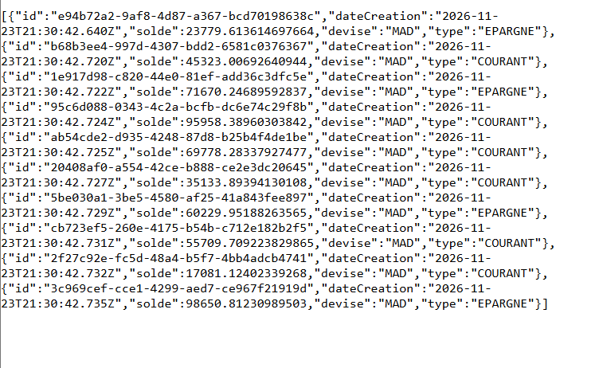
---

## Étape 6 : Test du web service avec Postman
Les différentes opérations du web service ont été testées avec le client REST **Postman**.

### GET – Liste des comptes
`GET http://localhost:8081/api/comptes`

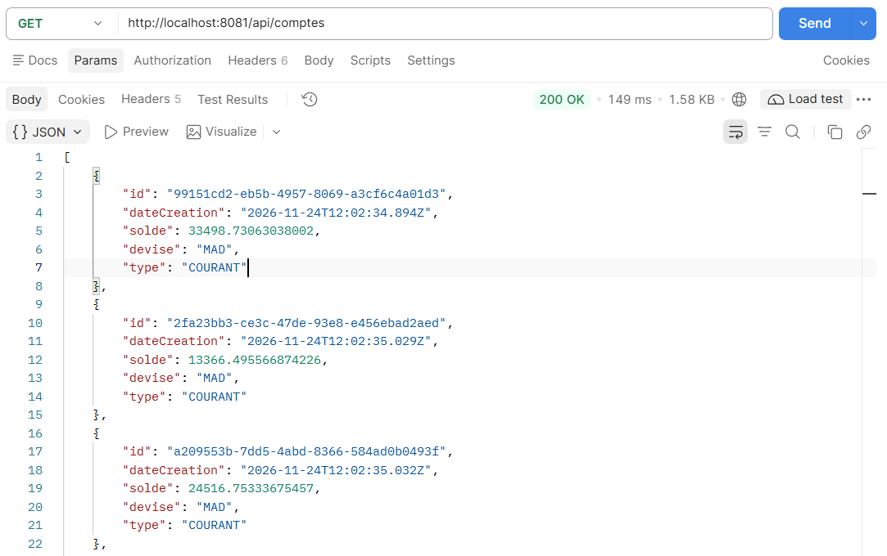

### GET – Consultation d'un compte
`GET http://localhost:8081/api/comptes/{id}`

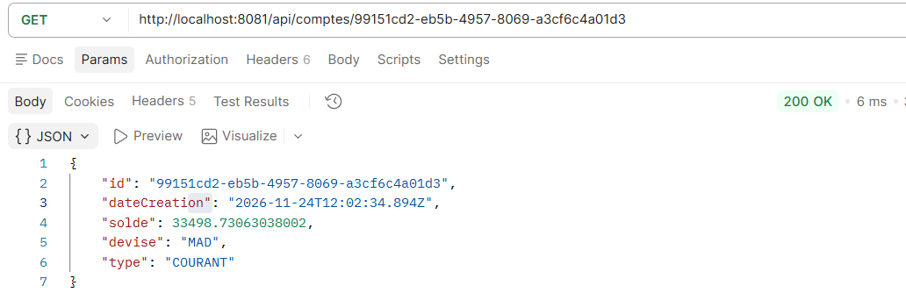

### POST – Ajout d'un compte
`POST http://localhost:8081/api/comptes`

Corps de la requête :
```json
{
  "solde": 50000,
  "devise": "MAD",
  "type": "COURANT"
}
```
L'identifiant et la date de création sont générés automatiquement.

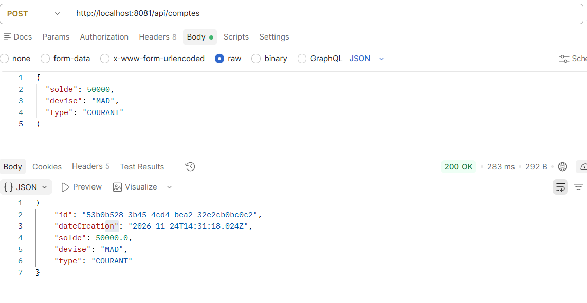

### PUT – Modification d'un compte
`PUT http://localhost:8081/api/comptes/{id}`

Corps de la requête :
```json
{
  "solde": 75000,
  "devise": "EUR"
}
```
Seuls les champs envoyés sont modifiés ; le type du compte reste inchangé.

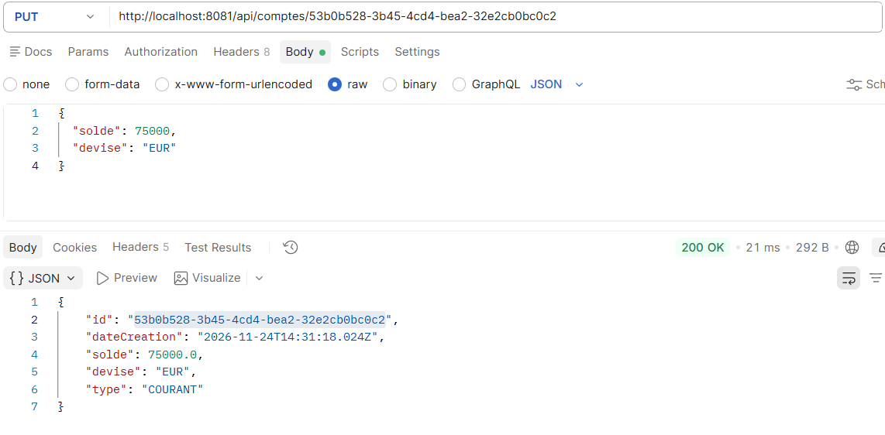

### DELETE – Suppression d'un compte
`DELETE http://localhost:8081/api/comptes/{id}`

Le compte est supprimé (statut `200 OK`) et n'apparaît plus dans la liste.

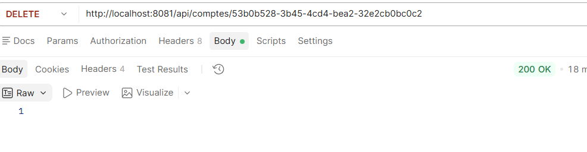
---

## Étape 6 : Test du web service avec Postman
Les différentes opérations du web service ont été testées avec le client REST **Postman**.

### GET – Liste des comptes
`GET http://localhost:8081/api/comptes`


### GET – Consultation d'un compte
`GET http://localhost:8081/api/comptes/{id}`


### POST – Ajout d'un compte
`POST http://localhost:8081/api/comptes`

Corps de la requête :
```json
{
  "solde": 50000,
  "devise": "MAD",
  "type": "COURANT"
}
```
L'identifiant et la date de création sont générés automatiquement.


### PUT – Modification d'un compte
`PUT http://localhost:8081/api/comptes/{id}`

Corps de la requête :
```json
{
  "solde": 75000,
  "devise": "EUR"
}
```
Seuls les champs envoyés sont modifiés ; le type du compte reste inchangé.


### DELETE – Suppression d'un compte
`DELETE http://localhost:8081/api/comptes/{id}`

Le compte est supprimé (statut `200 OK`) et n'apparaît plus dans la liste.


---

## Étape 7 : Documentation Swagger
La documentation de l'API REST est générée automatiquement grâce à la dépendance **springdoc-openapi** (version 3.x, compatible avec Spring Boot 4) :

```xml
<dependency>
    <groupId>org.springdoc</groupId>
    <artifactId>springdoc-openapi-starter-webmvc-ui</artifactId>
    <version>3.1.0</version>
</dependency>
```

Springdoc analyse les contrôleurs au démarrage de l'application et génère :
- la spécification **OpenAPI** au format JSON : `http://localhost:8081/v3/api-docs`
- l'interface graphique **Swagger UI** : `http://localhost:8081/swagger-ui.html`

### Interface Swagger UI
Toutes les opérations du contrôleur `CompteRestController` sont listées automatiquement :

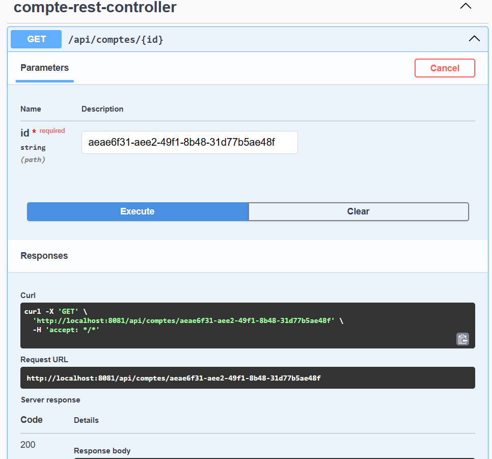


### Spécification OpenAPI (JSON)
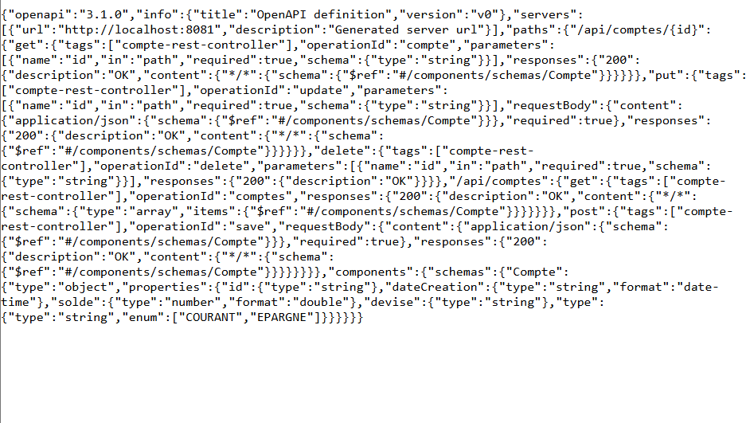
---

## Étape 8 : Spring Data Rest et projections

### Exposition automatique du repository
La dépendance **Spring Data Rest** (`spring-boot-starter-data-rest`) permet d'exposer automatiquement un repository Spring Data sous forme d'API REST, sans écrire de contrôleur.

L'interface `CompteRepository` a été annotée :
- `@RepositoryRestResource` : expose le repository sur l'URL `/comptes`
- `@RestResource(path = "/byType")` avec `@Param("t")` : expose la méthode `findByType` sur `/comptes/search/byType?t=...`

Les réponses sont au format **HAL** (`_embedded`, `_links`, `page`) et supportent la pagination.

#### Liste des comptes : `/comptes`
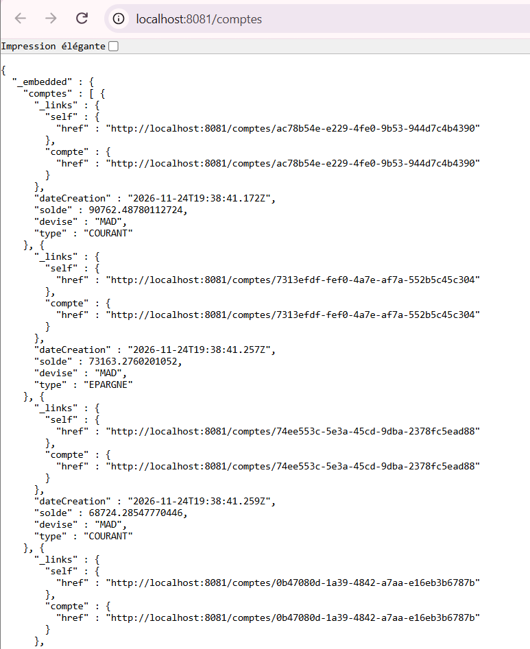

#### Recherche par type : `/comptes/search/byType?t=EPARGNE`
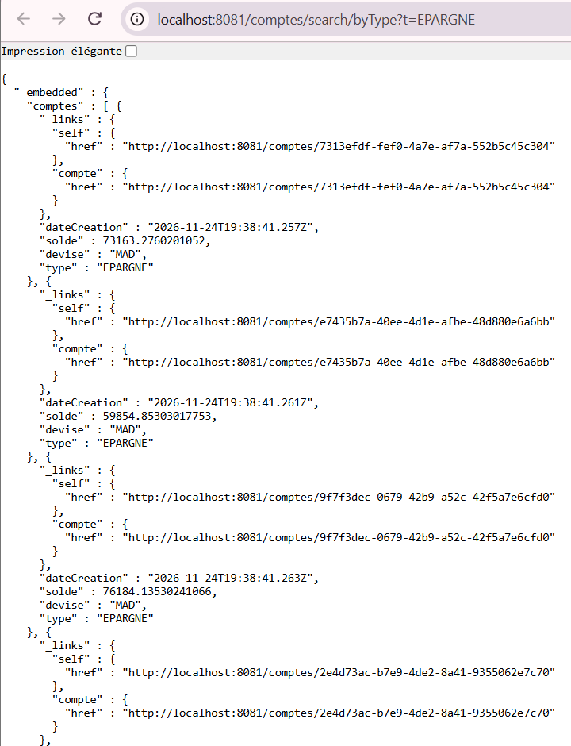

#### Pagination : `/comptes?page=0&size=3`
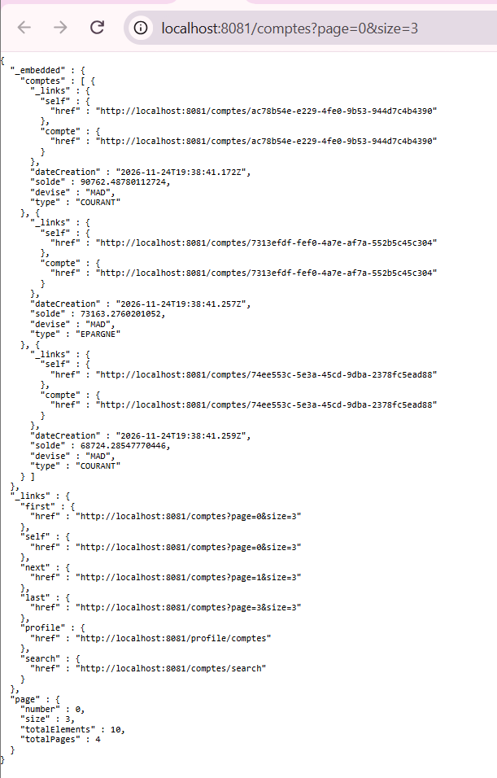

### Projections
Une projection permet de choisir les champs retournés par l'API sans modifier l'entité. L'interface `CompteProjection` définit la projection `p1`, qui ne retourne que l'identifiant, le solde et le type du compte :

```java
@Projection(types = Compte.class, name = "p1")
public interface CompteProjection {
    String getId();
    Double getSolde();
    TypeCompte getType();
}
```

#### Résultat : `/comptes?projection=p1`
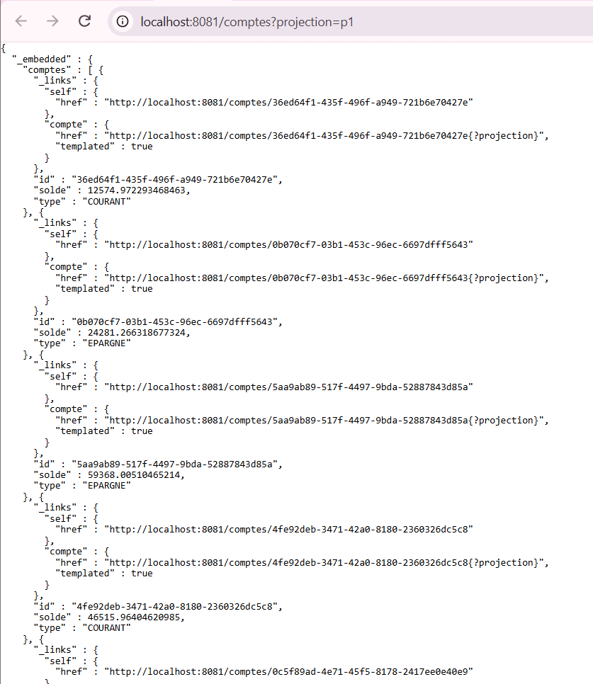
---

## Étape 9 : Création des DTOs et Mappers

### Les DTOs (Data Transfer Objects)
Les DTOs permettent de ne pas exposer directement les entités JPA aux clients de l'API et de contrôler les données échangées.

| DTO | Rôle | Attributs |
|---|---|---|
| `CompteRequestDTO` | Données envoyées par le client (ajout / modification) | `solde`, `devise`, `type` |
| `CompteResponseDTO` | Données renvoyées par le serveur | `id`, `dateCreation`, `solde`, `devise`, `type` |

L'identifiant et la date de création ne figurent pas dans `CompteRequestDTO` car ils sont générés par le serveur.

### Le Mapper
La classe `CompteMapper` (annotée `@Component`) assure la conversion entre l'entité et les DTOs :
- `fromCompte(Compte)` : convertit une entité `Compte` en `CompteResponseDTO`
- `fromCompteRequestDTO(CompteRequestDTO)` : convertit un `CompteRequestDTO` en entité `Compte`

La copie des attributs est réalisée avec `BeanUtils.copyProperties()` de Spring, qui copie les propriétés portant le même nom.
---

## Étape 10 : Création de la couche Service (métier)

### Architecture en couches
Une couche service a été ajoutée entre le contrôleur et le repository :

```
Contrôleur (web)  →  Service (métier)  →  Repository (DAO)  →  Base H2
```

Le contrôleur ne communique plus directement avec le repository : il délègue tous les traitements au service et échange uniquement des **DTOs** avec le client.

### L'interface `CompteService`
Elle définit les opérations métier :

| Méthode | Description |
|---|---|
| `getComptes()` | Retourne la liste des comptes |
| `getCompte(String id)` | Retourne un compte par son identifiant |
| `addCompte(CompteRequestDTO)` | Ajoute un compte |
| `updateCompte(String id, CompteRequestDTO)` | Modifie un compte (seuls les champs fournis sont modifiés) |
| `deleteCompte(String id)` | Supprime un compte |

### L'implémentation `CompteServiceImpl`
- `@Service` : déclare la classe comme bean de la couche métier
- `@Transactional` : chaque méthode s'exécute dans une transaction (rollback en cas d'erreur)
- Le service génère l'identifiant (`UUID`) et la date de création lors de l'ajout
- Les conversions entre entités et DTOs sont réalisées avec `CompteMapper`

### Modification du contrôleur
`CompteRestController` utilise désormais `CompteService` au lieu de `CompteRepository` : il reçoit des `CompteRequestDTO` et renvoie des `CompteResponseDTO`.

### Tests avec Postman

#### Ajout d'un compte via le service
`POST http://localhost:8081/api/comptes`

```json
{
  "solde": 60000,
  "devise": "MAD",
  "type": "EPARGNE"
}
```

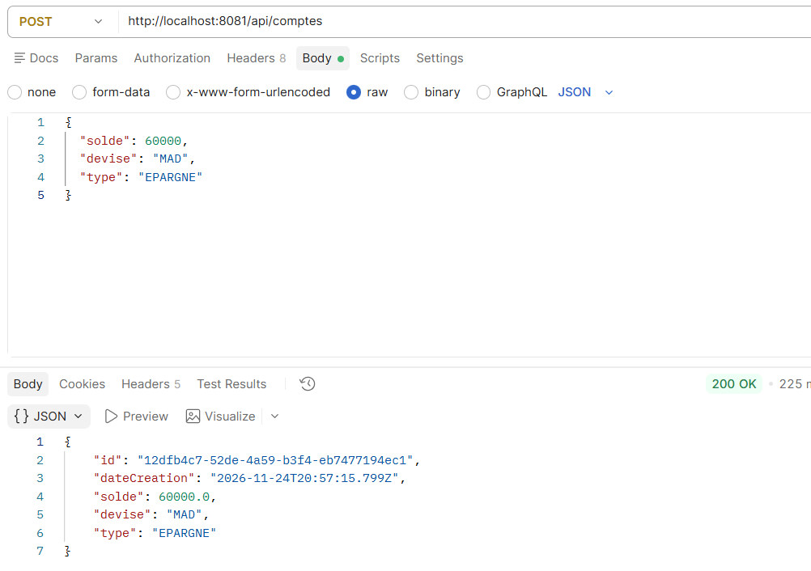

#### Modification d'un compte via le service
`PUT http://localhost:8081/api/comptes/{id}`

```json
{
  "solde": 80000
}
```

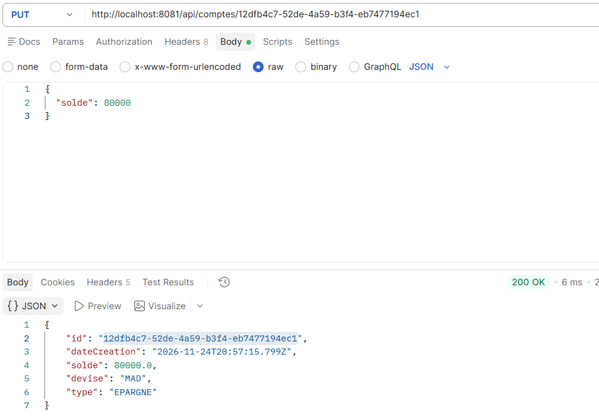
---

## Étape 11 : Web service GraphQL

### Principe
Contrairement à REST (une URL par ressource, champs fixés par le serveur), **GraphQL** expose une **seule URL** (`/graphql`) et permet au **client de choisir exactement les champs** qu'il souhaite recevoir.

### Configuration
- Dépendance ajoutée : `spring-boot-starter-graphql`
- Activation de l'interface de test **GraphiQL** dans `application.properties` :
```properties
spring.graphql.graphiql.enabled=true
```
L'interface est accessible sur `http://localhost:8081/graphiql`.

### Le schéma GraphQL (`resources/graphql/schema.graphqls`)
```graphql
type Query {
    comptes: [Compte]
    compteById(id: String): Compte
}

type Mutation {
    addCompte(compte: CompteDTO): Compte
    updateCompte(id: String, compte: CompteDTO): Compte
    deleteCompte(id: String): Boolean
}

type Compte {
    id: String
    dateCreation: String
    solde: Float
    devise: String
    type: TypeCompte
}

input CompteDTO {
    solde: Float
    devise: String
    type: TypeCompte
}

enum TypeCompte {
    COURANT
    EPARGNE
}
```
- `Query` : opérations de lecture
- `Mutation` : opérations d'ajout, de modification et de suppression
- `type Compte` : données renvoyées (correspond à `CompteResponseDTO`)
- `input CompteDTO` : données envoyées (correspond à `CompteRequestDTO`)

### Le contrôleur `CompteGraphQLController`
- `@Controller` : contrôleur GraphQL
- `@QueryMapping` / `@MutationMapping` : associent chaque méthode à l'opération du schéma portant le même nom
- `@Argument` : récupère les arguments de la requête GraphQL

Le contrôleur GraphQL réutilise la **même couche service** (`CompteService`) que le contrôleur REST : la logique métier n'est pas dupliquée.

### Tests avec GraphiQL

#### Query : liste des comptes (seulement id, solde et type)
```graphql
query {
  comptes {
    id
    solde
    type
  }
}
```
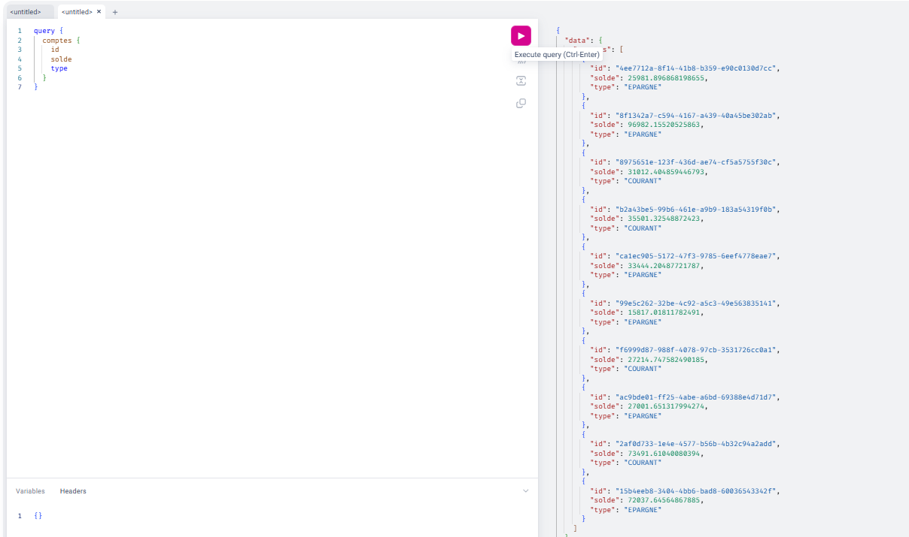

#### Query : consultation d'un compte
```graphql
query {
  compteById(id: "...") {
    id
    dateCreation
    solde
    devise
    type
  }
}
```
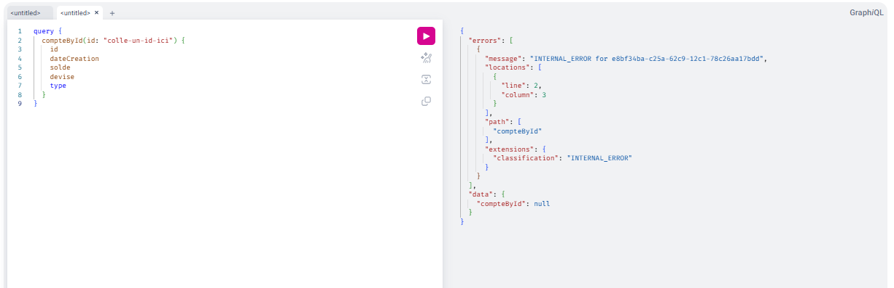

#### Mutation : ajout d'un compte
```graphql
mutation {
  addCompte(compte: { solde: 45000, devise: "EUR", type: COURANT }) {
    id
    dateCreation
    solde
    devise
    type
  }
}
```
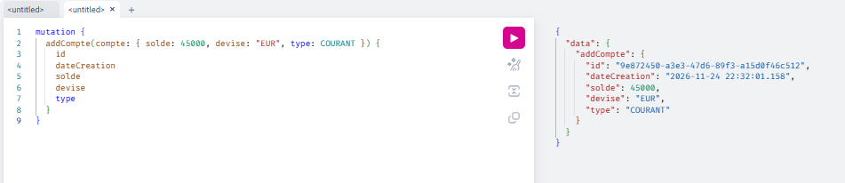

#### Mutation : modification d'un compte
```graphql
mutation {
  updateCompte(id: "...", compte: { solde: 99000 }) {
    id
    solde
    devise
    type
  }
}
```
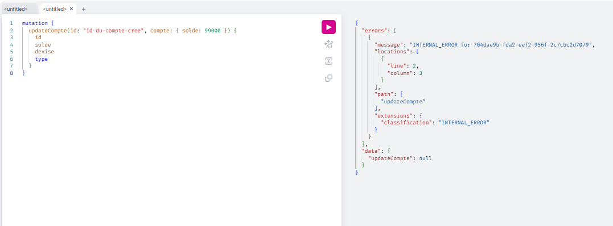

#### Mutation : suppression d'un compte
```graphql
mutation {
  deleteCompte(id: "...")
}
```
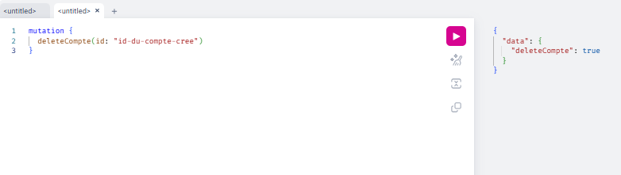

---

## Conclusion
Cette activité a permis de réaliser un micro-service complet de gestion de comptes bancaires avec Spring Boot, en suivant une architecture en couches :
- une couche **DAO** basée sur Spring Data JPA et la base H2 ;
- une couche **métier** (service) utilisant des **DTOs** et un **mapper** pour ne pas exposer directement les entités ;
- une couche **web** exposant les mêmes fonctionnalités de plusieurs façons : un **web service RESTful** documenté avec **Swagger**, une API générée automatiquement par **Spring Data Rest** (avec pagination et **projections**), et un **web service GraphQL** permettant au client de choisir les données qu'il reçoit.

Cette activité montre la complémentarité de REST et GraphQL, et l'intérêt de centraliser la logique métier dans une couche service réutilisable par les différents contrôleurs.